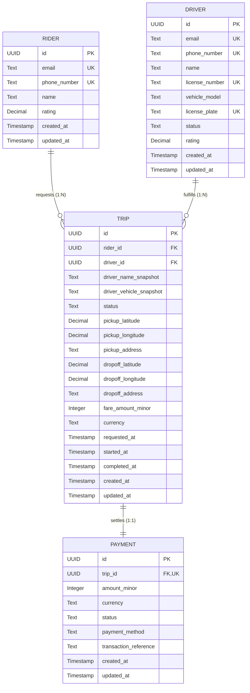
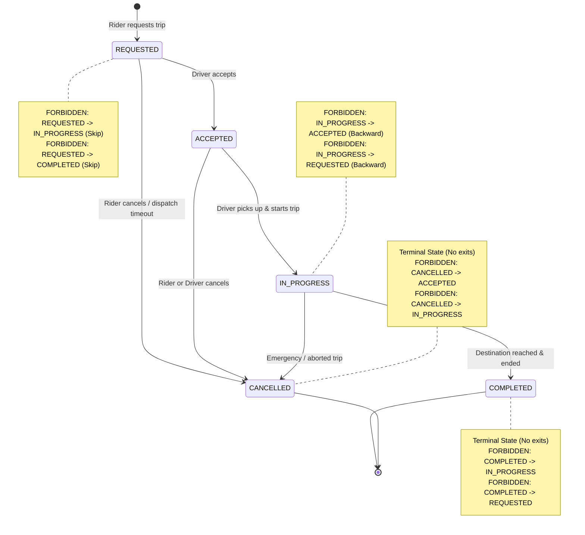

# Ride-Hailing Service

## Step 1: The Requirements

This product is a ride-hailing service that connects riders seeking transportation with drivers providing rides. The platform facilitates real-time matchmaking, journey tracking, and seamless payment processing.

**Target Users:**
- **Riders**: Individuals who need a ride from one location to another.
- **Drivers**: Individuals with vehicles who offer rides for compensation.

**Top 5 Core Actions:**
1. **Rider requests a trip**: A rider inputs their pickup and drop-off locations to request a ride.
2. **Driver accepts the trip**: Available drivers in the area receive the request, and one accepts it.
3. **Driver starts the trip**: After picking up the rider, the driver initiates the trip in the system.
4. **Driver completes the trip**: Upon reaching the destination, the driver marks the trip as completed.
5. **Payment is processed**: The system automatically calculates the fare and processes the payment from the rider to the driver.

## Step 2: Entity Modeling & Relationships

### Primary Key Strategy
All primary keys use generated UUIDs rather than auto-incrementing sequential integers to eliminate predictability and prevent enumeration attacks, avoid key collisions in distributed environments, and allow safe client or service-level identifier generation.

---

### Core Entities

#### 1. Rider
Represents a registered passenger who requests rides and pays for transportation services on the platform.

| Field | Type | Nullable | Description |
|---|---|---|---|
| `id` | UUID | No | Unique primary key identifier for the rider. |
| `email` | Text | No | Unique email address for authentication and communication. |
| `phone_number` | Text | No | Unique phone number used for SMS verification and driver communication. |
| `name` | Text | No | Full name of the rider. |
| `rating` | Decimal(3,2) | Yes | Average rating received from drivers (ranges from 1.00 to 5.00; null for new riders). |
| `created_at` | Timestamp | No | Record creation timestamp. |
| `updated_at` | Timestamp | No | Timestamp of the last record update. |

---

#### 2. Driver
Represents an approved vehicle operator who receives, accepts, and fulfills trip requests.

| Field | Type | Nullable | Description |
|---|---|---|---|
| `id` | UUID | No | Unique primary key identifier for the driver. |
| `email` | Text | No | Unique email address for authentication and communication. |
| `phone_number` | Text | No | Unique phone number used for SMS verification and rider contact. |
| `name` | Text | No | Full name of the driver. |
| `license_number` | Text | No | Official driver's license identifier. |
| `vehicle_model` | Text | No | Make and model of the registered vehicle (e.g., Toyota Camry). |
| `license_plate` | Text | No | Unique vehicle registration license plate. |
| `status` | Text (Enum) | No | Driver availability state (`AVAILABLE`, `BUSY`, `OFFLINE`). |
| `rating` | Decimal(3,2) | Yes | Average rating received from riders (ranges from 1.00 to 5.00; null for new drivers). |
| `created_at` | Timestamp | No | Record creation timestamp. |
| `updated_at` | Timestamp | No | Timestamp of the last record update. |

---

#### 3. Trip
Represents an individual journey from initial ride request to pickup, transit, and destination arrival or cancellation.

| Field | Type | Nullable | Description |
|---|---|---|---|
| `id` | UUID | No | Unique primary key identifier for the trip. |
| `rider_id` | UUID | No | Foreign key referencing the `Rider` who requested the trip. |
| `driver_id` | UUID | Yes | Foreign key referencing the assigned `Driver` (null while searching for a driver). |
| `driver_name_snapshot` | Text | Yes | Snapshot of the driver's full name at the moment the ride is accepted. |
| `driver_vehicle_snapshot` | Text | Yes | Snapshot of the driver's vehicle make/model/plate at the moment the ride is accepted. |
| `status` | Text (Enum) | No | Current lifecycle status (`REQUESTED`, `ACCEPTED`, `IN_PROGRESS`, `COMPLETED`, `CANCELLED`). |
| `pickup_latitude` | Decimal(9,6) | No | Latitude coordinate of the rider's pickup location. |
| `pickup_longitude` | Decimal(9,6) | No | Longitude coordinate of the rider's pickup location. |
| `pickup_address` | Text | No | Human-readable address or landmark for pickup. |
| `dropoff_latitude` | Decimal(9,6) | No | Latitude coordinate of the rider's drop-off destination. |
| `dropoff_longitude` | Decimal(9,6) | No | Longitude coordinate of the rider's drop-off destination. |
| `dropoff_address` | Text | No | Human-readable address or landmark for drop-off. |
| `fare_amount_minor` | Integer | Yes | Final calculated fare amount in minor currency units (e.g., cents/kobo; computed upon completion). |
| `currency` | Text | No | Three-letter ISO currency code (e.g., `USD`, `NGN`). |
| `requested_at` | Timestamp | No | Timestamp when the trip was requested by the rider. |
| `started_at` | Timestamp | Yes | Timestamp when the driver arrived and initiated the ride. |
| `completed_at` | Timestamp | Yes | Timestamp when the driver finished the ride at destination. |
| `created_at` | Timestamp | No | Record creation timestamp. |
| `updated_at` | Timestamp | No | Timestamp of the last record update. |

---

#### 4. Payment
Represents the financial settlement transaction corresponding to a completed ride.

| Field | Type | Nullable | Description |
|---|---|---|---|
| `id` | UUID | No | Unique primary key identifier for the payment. |
| `trip_id` | UUID | No | Unique foreign key referencing the completed `Trip`. |
| `amount_minor` | Integer | No | Total monetary amount charged to the rider in minor currency units (e.g., cents, kobo). |
| `currency` | Text | No | Three-letter ISO currency code (e.g., `USD`, `EUR`, `NGN`). |
| `status` | Text (Enum) | No | Payment processing status (`PENDING`, `COMPLETED`, `FAILED`, `REFUNDED`). |
| `payment_method` | Text (Enum) | No | Payment method used (`CREDIT_CARD`, `DEBIT_CARD`, `WALLET`, `CASH`). |
| `transaction_reference` | Text | Yes | External payment gateway transaction reference or receipt ID. |
| `created_at` | Timestamp | No | Record creation timestamp. |
| `updated_at` | Timestamp | No | Timestamp of the last record update. |

---

### Cardinality & Relationships

- **Rider to Trip (1:Many)**: One rider can request many trips over time, but each trip belongs to exactly one rider (`Trip.rider_id -> Rider.id`).
- **Driver to Trip (1:Many)**: One driver can fulfill many trips over time, but each trip is assigned to at most one driver (`Trip.driver_id -> Driver.id`).
- **Trip to Payment (1:1)**: Each trip has at most one corresponding payment record, and each payment is tied strictly to a single trip via a unique foreign key constraint (`Payment.trip_id -> Trip.id`).



## Step 3: The Hard Questions

### 1. Normalisation & Deliberate Denormalisation
While normalized schemas reduce redundancy and prevent update anomalies, high-throughput transactional systems deliberately denormalize specific fields to guarantee historical immutability, audit integrity, and high-performance querying without complex joins.

**Two Deliberate Denormalisations:**
1. **Driver Profile Snapshot on `Trip` (`driver_name_snapshot`, `driver_vehicle_snapshot`)**:
   - *Justification*: When a ride occurs, it is legally and operationally bound to the driver's identity and specific vehicle at that exact moment. Drivers update vehicle models, change license plates, or alter profile names over time. Relying solely on `Trip.driver_id -> Driver` would cause historic trip receipts to display the driver's *current* vehicle rather than what was actually driven during that trip. Denormalizing snapshots directly onto `Trip` preserves an immutable audit record and complies with passenger safety and dispute regulations.
2. **Fare Snapshot & Currency on `Trip` (`fare_amount_minor`, `currency`) alongside `Payment` (`amount_minor`)**:
   - *Justification*: Storing the calculated fare directly on `Trip` upon ride completion fixes the contract between the rider and driver for that specific journey. This enables trip receipt and rider ride-history queries to be served from the `trips` table alone without an inner join to `payments`, while also allowing reconciliation audits to verify that `Payment.amount_minor` strictly matches `Trip.fare_amount_minor`.

---

### 2. Money
Financial calculations must never use floating-point types (`FLOAT`, `DOUBLE`, `REAL`) due to IEEE 754 precision issues (e.g., `0.1 + 0.2 = 0.30000000000000004`).

- **Minor-Unit Integer Rule**: All monetary values are strictly stored as integers in their smallest non-divisible fractional currency unit (minor unit). For example:
  - `$25.50 USD` is stored as `2550` cents.
  - `₦5,000.00 NGN` is stored as `500000` kobo.
  - `¥1,000 JPY` is stored as `1000` yen.
  Integer arithmetic is exact, deterministic, and safe against rounding drift across application layers and databases.
- **Currency Column Rule**: Every monetary amount column (`fare_amount_minor`, `amount_minor`) is paired with an ISO 4217 three-letter uppercase text column (`currency`). Cross-currency operations without explicit currency conversion services are prohibited, and `Payment.currency` must match `Trip.currency`.

---

### 3. Status and State Machine
A `Trip` follows a strict deterministic lifecycle:
`REQUESTED` -> `ACCEPTED` -> `IN_PROGRESS` -> `COMPLETED` (or `CANCELLED`).



#### Allowed Transitions:
1. `REQUESTED` -> `ACCEPTED`: Triggered when an active driver accepts the ride. Sets `driver_id`, `driver_name_snapshot`, and `driver_vehicle_snapshot`.
2. `REQUESTED` -> `CANCELLED`: Triggered when the rider cancels before a driver accepts, or when dispatch matchmaking times out.
3. `ACCEPTED` -> `IN_PROGRESS`: Triggered when the driver picks up the rider and starts the ride. Sets `started_at`.
4. `ACCEPTED` -> `CANCELLED`: Triggered if the rider or driver cancels before transit begins.
5. `IN_PROGRESS` -> `COMPLETED`: Triggered when the driver arrives at the drop-off destination and completes the ride. Sets `completed_at` and `fare_amount_minor`.
6. `IN_PROGRESS` -> `CANCELLED`: Triggered in exceptional situations (e.g., vehicle breakdown, emergency, or support intervention).

#### Forbidden Transitions:
- **Terminal States**: `COMPLETED` and `CANCELLED` are terminal. No transitions out of terminal states are permitted (e.g., `COMPLETED` -> `IN_PROGRESS` or `CANCELLED` -> `ACCEPTED` are strictly forbidden).
- **Backward Steps**: `IN_PROGRESS` -> `ACCEPTED` or `ACCEPTED` -> `REQUESTED` are forbidden.
- **Skip Steps**: `REQUESTED` -> `IN_PROGRESS` or `REQUESTED` -> `COMPLETED` are forbidden.

#### Enforcement Mechanisms:
- **Database Layer**: Enforced via PostgreSQL `CHECK` constraints (e.g., verifying `started_at` is non-null when `status = 'IN_PROGRESS'`).
- **Application & Concurrency Layer**: Enforced via atomic conditional SQL queries with optimistic state matching:
  ```sql
  UPDATE trips
  SET status = 'ACCEPTED', driver_id = $driver_id, updated_at = NOW()
  WHERE id = $trip_id AND status = 'REQUESTED';
  ```
  If zero rows are updated, the request is rejected with `409 Conflict`, preventing race conditions (e.g., two drivers attempting to accept the same trip).

---

### 4. Time & Deletions

- **`createdAt` and `updatedAt` Rules**:
  - `created_at`: `TIMESTAMP WITH TIME ZONE DEFAULT CURRENT_TIMESTAMP NOT NULL`, set once upon insert and immutable.
  - `updated_at`: `TIMESTAMP WITH TIME ZONE DEFAULT CURRENT_TIMESTAMP NOT NULL`, automatically updated on every row modification via ORM hooks (`@updatedAt`) or database triggers.
  - All timestamps are standardized in UTC (`TIMESTAMPTZ`) to prevent timezone inconsistencies across geographic jurisdictions.

- **Soft Deletion vs. Hard Deletion Strategy**:
  - **Rider (`deleted_at: Timestamp | Nullable`) - Soft Deletion**: Riders can request account deletion (e.g., GDPR / CCPA right to erasure). Soft deletion marks the account inactive and triggers PII masking/anonymization, while preserving the underlying user identifier to maintain relational integrity with historic trip ledgers.
  - **Driver (`deleted_at: Timestamp | Nullable`) - Soft Deletion**: Transport and licensing regulations require maintaining audit records of driver qualifications, vehicle inspections, and ride history. Deactivated or terminated drivers are soft-deleted, preventing login and dispatch while retaining historical records.
  - **Trip (No Deletion / Append-Only) - Immutable**: Trips must **never** be hard-deleted or soft-deleted. Every trip record (including cancelled ones) is an immutable operational and financial transaction required for tax auditing, passenger safety investigations, and dispute arbitration.
  - **Payment (No Deletion / Append-Only) - Immutable**: Hard deletion is strictly forbidden by financial compliance laws (GAAP, IFRS, PCI-DSS, AML). Payments represent permanent ledger entries. Refunds or adjustments are handled as separate payment/refund records rather than deleting or modifying prior payments.

---

### 5. Identifiers
All primary keys use generated UUIDs (UUIDv4/UUIDv7) rather than auto-incrementing sequential integers:
- **Defense Against Enumeration & IDOR Attacks**: Sequential IDs (`/trips/1001`, `/trips/1002`) allow attackers to enumerate user records, scrape data, or estimate total business transaction volume. UUIDs provide unguessable, high-entropy identifiers.
- **Decentralized Generation**: Application servers and microservices can generate unique IDs client-side or before hitting the database without coordinating through a central lock or single-point-of-failure auto-increment sequence.

---

### 6. Constraints

The schema uses strict table-level constraints to prevent illegal states:

1. **Active Trip Mutual Exclusion (Partial Unique Indexes)**:
   - Prevents a rider from requesting or having multiple concurrent active trips:
     ```sql
     CREATE UNIQUE INDEX idx_unique_active_trip_rider
     ON trips (rider_id)
     WHERE status IN ('REQUESTED', 'ACCEPTED', 'IN_PROGRESS');
     ```
   - Prevents a driver from being assigned to multiple concurrent active trips:
     ```sql
     CREATE UNIQUE INDEX idx_unique_active_trip_driver
     ON trips (driver_id)
     WHERE status IN ('ACCEPTED', 'IN_PROGRESS');
     ```
2. **Payment-Trip Integrity**:
   - `Payment.trip_id NOT NULL UNIQUE REFERENCES trips(id) ON DELETE RESTRICT`: Guarantees a payment cannot exist without a trip, prevents orphaned payments, and ensures a trip cannot be paid for twice.
3. **Non-Negative Monetary Amounts**:
   - `CHECK (fare_amount_minor >= 0)` on `trips`.
   - `CHECK (amount_minor >= 0)` on `payments`.
4. **Geographic Coordinate Validation**:
   - `CHECK (pickup_latitude BETWEEN -90.0 AND 90.0 AND pickup_longitude BETWEEN -180.0 AND 180.0)`
   - `CHECK (dropoff_latitude BETWEEN -90.0 AND 90.0 AND dropoff_longitude BETWEEN -180.0 AND 180.0)`
5. **Chronological Integrity**:
   - `CHECK (started_at IS NULL OR started_at >= requested_at)`
   - `CHECK (completed_at IS NULL OR completed_at >= started_at)`

---

### 7. Indexes
Specific B-tree indexes are designed to optimize each of the 5 core user actions:

1. **Action 1: Rider requests a trip**
   - *Index*: `CREATE UNIQUE INDEX idx_trips_rider_active ON trips (rider_id) WHERE status IN ('REQUESTED', 'ACCEPTED', 'IN_PROGRESS');`
   - *Optimization*: O(1) index check verifying the rider does not have an active booking before creating a new trip.
2. **Action 2: Driver accepts trip**
   - *Index*: `CREATE INDEX idx_trips_status_requested_time ON trips (status, requested_at) WHERE status = 'REQUESTED';`
   - *Index*: `CREATE INDEX idx_drivers_status ON drivers (status);`
   - *Optimization*: Instantly queries available dispatch requests ordered by request time and filters available drivers.
3. **Action 3: Driver starts trip**
   - *Index*: `CREATE INDEX idx_trips_driver_active ON trips (driver_id) WHERE status = 'ACCEPTED';`
   - *Optimization*: Direct index lookup for the driver's currently accepted trip awaiting pickup.
4. **Action 4: Driver completes trip**
   - *Index*: Primary Key index on `trips (id)`.
   - *Optimization*: Sub-millisecond direct row lookup by trip ID to update status and set final timestamps and fare.
5. **Action 5: Payment is processed**
   - *Index*: `CREATE UNIQUE INDEX idx_payments_trip_id ON payments (trip_id);`
   - *Index*: `CREATE INDEX idx_payments_status ON payments (status);`
   - *Optimization*: Guarantees instant verification of whether payment exists for a completed trip and accelerates payment reconciliation queries.

---

## Step 4: API Design & Endpoint Contracts

All API endpoints follow RESTful conventions, reside under the `/api/v1` namespace, use JSON request/response bodies, and return a consistent response envelope:
```json
{
  "data": { ... } | [ ... ],
  "meta": { ... }
}
```
Errors return a standard envelope with an RFC 7807-compatible error descriptor:
```json
{
  "error": {
    "code": "CONFLICT",
    "message": "Trip cannot be accepted in its current state.",
    "details": [ ... ]
  }
}
```

---

### 1. Endpoint Contracts for the 5 Core Actions

#### Action 1: Rider Requests a Trip
- **Method & Path**: `POST /api/v1/trips`
- **Idempotency**: **Required** (`Idempotency-Key` header).
  - *Database Enforcement*: Enforced by inserting an atomic record into `idempotency_keys` table (`key`, `request_hash`, `response_body`) within the same database transaction. Duplicate requests return the previously generated response without re-executing booking logic. Additionally, the partial unique index `idx_unique_active_trip_rider` rejects concurrent bookings at the database tier.
- **Request Headers**:
  - `Content-Type: application/json`
  - `Idempotency-Key: <UUIDv4>` (Required)
- **Request Body**:
  ```json
  {
    "rider_id": "9b1deb4d-3b7d-4bad-9bdd-2b0d7b3dcb6d", // UUID, required
    "pickup_latitude": 37.774929,                       // Decimal/Number [-90, 90], required
    "pickup_longitude": -122.419416,                    // Decimal/Number [-180, 180], required
    "pickup_address": "795 Folsom St, San Francisco, CA",// String, required
    "dropoff_latitude": 37.789172,                      // Decimal/Number [-90, 90], required
    "dropoff_longitude": -122.401449,                   // Decimal/Number [-180, 180], required
    "dropoff_address": "Market St & 4th St, San Francisco, CA", // String, required
    "currency": "USD"                                   // String (ISO 4217, 3 chars), required
  }
  ```
- **Response Body (201 Created)**:
  ```json
  {
    "data": {
      "id": "c3a2f07d-5a7e-48f8-b615-546ec84d8583",
      "rider_id": "9b1deb4d-3b7d-4bad-9bdd-2b0d7b3dcb6d",
      "driver_id": null,
      "driver_name_snapshot": null,
      "driver_vehicle_snapshot": null,
      "status": "REQUESTED",
      "pickup_latitude": 37.774929,
      "pickup_longitude": -122.419416,
      "pickup_address": "795 Folsom St, San Francisco, CA",
      "dropoff_latitude": 37.789172,
      "dropoff_longitude": -122.401449,
      "dropoff_address": "Market St & 4th St, San Francisco, CA",
      "fare_amount_minor": null,
      "currency": "USD",
      "requested_at": "2026-10-09T18:00:00.000Z",
      "started_at": null,
      "completed_at": null,
      "created_at": "2026-10-09T18:00:00.000Z",
      "updated_at": "2026-10-09T18:00:00.000Z"
    },
    "meta": {
      "idempotent_replayed": false
    }
  }
  ```
- **Possible Errors**:
  - `400 Bad Request`: Missing mandatory fields or malformed JSON.
  - `404 Not Found`: `rider_id` does not match an existing rider.
  - `409 Conflict`: Rider already has an active trip (`REQUESTED`, `ACCEPTED`, or `IN_PROGRESS`).
  - `422 Unprocessable Entity`: Latitude/Longitude coordinates outside valid physical ranges (`[-90, 90]`, `[-180, 180]`) or invalid ISO currency.

---

#### Action 2: Driver Accepts the Trip
- **Method & Path**: `POST /api/v1/trips/:id/accept`
- **Idempotency**: Handled via state precondition check (`WHERE status = 'REQUESTED'`). If re-executed by the same driver, returns current state; if accepted by another driver, returns `409 Conflict`.
- **Request Headers**:
  - `Content-Type: application/json`
- **Request Body**:
  ```json
  {
    "driver_id": "2d8f990a-6e21-4d32-9cb5-ef31398865c1" // UUID, required
  }
  ```
- **Response Body (200 OK)**:
  ```json
  {
    "data": {
      "id": "c3a2f07d-5a7e-48f8-b615-546ec84d8583",
      "rider_id": "9b1deb4d-3b7d-4bad-9bdd-2b0d7b3dcb6d",
      "driver_id": "2d8f990a-6e21-4d32-9cb5-ef31398865c1",
      "driver_name_snapshot": "Marcus Vance",
      "driver_vehicle_snapshot": "Toyota Camry 2023 - 7XYZ890",
      "status": "ACCEPTED",
      "pickup_latitude": 37.774929,
      "pickup_longitude": -122.419416,
      "pickup_address": "795 Folsom St, San Francisco, CA",
      "dropoff_latitude": 37.789172,
      "dropoff_longitude": -122.401449,
      "dropoff_address": "Market St & 4th St, San Francisco, CA",
      "fare_amount_minor": null,
      "currency": "USD",
      "requested_at": "2026-10-09T18:00:00.000Z",
      "started_at": null,
      "completed_at": null,
      "created_at": "2026-10-09T18:00:00.000Z",
      "updated_at": "2026-10-09T18:02:15.000Z"
    },
    "meta": {
      "transition": "REQUESTED -> ACCEPTED"
    }
  }
  ```
- **Possible Errors**:
  - `400 Bad Request`: Invalid UUID format for `:id` or `driver_id`.
  - `404 Not Found`: Trip or Driver does not exist.
  - `409 Conflict`: Trip is no longer in `REQUESTED` state (already accepted or cancelled), or the driver is currently assigned to another active trip.
  - `422 Unprocessable Entity`: Driver account is offline or suspended.

---

#### Action 3: Driver Starts the Trip
- **Method & Path**: `POST /api/v1/trips/:id/start`
- **Idempotency**: State-guarded transition. Subsequent calls return 200 if already started by the assigned driver.
- **Request Headers**:
  - `Content-Type: application/json`
- **Request Body**:
  ```json
  {
    "driver_id": "2d8f990a-6e21-4d32-9cb5-ef31398865c1" // UUID, required (must match assigned driver)
  }
  ```
- **Response Body (200 OK)**:
  ```json
  {
    "data": {
      "id": "c3a2f07d-5a7e-48f8-b615-546ec84d8583",
      "rider_id": "9b1deb4d-3b7d-4bad-9bdd-2b0d7b3dcb6d",
      "driver_id": "2d8f990a-6e21-4d32-9cb5-ef31398865c1",
      "driver_name_snapshot": "Marcus Vance",
      "driver_vehicle_snapshot": "Toyota Camry 2023 - 7XYZ890",
      "status": "IN_PROGRESS",
      "pickup_latitude": 37.774929,
      "pickup_longitude": -122.419416,
      "pickup_address": "795 Folsom St, San Francisco, CA",
      "dropoff_latitude": 37.789172,
      "dropoff_longitude": -122.401449,
      "dropoff_address": "Market St & 4th St, San Francisco, CA",
      "fare_amount_minor": null,
      "currency": "USD",
      "requested_at": "2026-10-09T18:00:00.000Z",
      "started_at": "2026-10-09T18:07:30.000Z",
      "completed_at": null,
      "created_at": "2026-10-09T18:00:00.000Z",
      "updated_at": "2026-10-09T18:07:30.000Z"
    },
    "meta": {
      "transition": "ACCEPTED -> IN_PROGRESS"
    }
  }
  ```
- **Possible Errors**:
  - `400 Bad Request`: Malformed UUID.
  - `404 Not Found`: Trip not found.
  - `409 Conflict`: Trip is not in `ACCEPTED` status (e.g., still `REQUESTED`, already `COMPLETED`, or `CANCELLED`).
  - `422 Unprocessable Entity`: Requesting driver is not the assigned driver for this trip.

---

#### Action 4: Driver Completes the Trip
- **Method & Path**: `POST /api/v1/trips/:id/complete`
- **Idempotency**: State-guarded transition.
- **Request Headers**:
  - `Content-Type: application/json`
- **Request Body**:
  ```json
  {
    "driver_id": "2d8f990a-6e21-4d32-9cb5-ef31398865c1", // UUID, required
    "final_distance_meters": 4820,                        // Integer >= 0, required
    "toll_amount_minor": 0                                // Integer >= 0, optional
  }
  ```
- **Response Body (200 OK)**:
  ```json
  {
    "data": {
      "id": "c3a2f07d-5a7e-48f8-b615-546ec84d8583",
      "rider_id": "9b1deb4d-3b7d-4bad-9bdd-2b0d7b3dcb6d",
      "driver_id": "2d8f990a-6e21-4d32-9cb5-ef31398865c1",
      "driver_name_snapshot": "Marcus Vance",
      "driver_vehicle_snapshot": "Toyota Camry 2023 - 7XYZ890",
      "status": "COMPLETED",
      "fare_amount_minor": 2450,
      "currency": "USD",
      "requested_at": "2026-10-09T18:00:00.000Z",
      "started_at": "2026-10-09T18:07:30.000Z",
      "completed_at": "2026-10-09T18:24:10.000Z",
      "created_at": "2026-10-09T18:00:00.000Z",
      "updated_at": "2026-10-09T18:24:10.000Z"
    },
    "meta": {
      "transition": "IN_PROGRESS -> COMPLETED",
      "fare_breakdown": {
        "base_fare_minor": 500,
        "distance_fare_minor": 1450,
        "time_fare_minor": 500,
        "total_fare_minor": 2450
      }
    }
  }
  ```
- **Possible Errors**:
  - `400 Bad Request`: Missing `driver_id` or negative distance parameter.
  - `404 Not Found`: Trip not found.
  - `409 Conflict`: Trip is not in `IN_PROGRESS` state (cannot complete a trip that was not started or is already completed/cancelled).
  - `422 Unprocessable Entity`: Requesting driver is not the assigned driver.

---

#### Action 5: Payment is Processed
- **Method & Path**: `POST /api/v1/trips/:id/payments`
- **Idempotency**: **Required** (`Idempotency-Key` header).
  - *Database Enforcement*: Unique constraint on `payments (trip_id)` strictly prohibits duplicate payments for the same trip. In addition, `Idempotency-Key` is recorded in the transaction table. If a duplicate submission occurs, the existing payment record is returned without re-authorizing the payment gateway.
- **Request Headers**:
  - `Content-Type: application/json`
  - `Idempotency-Key: <UUIDv4>` (Required)
- **Request Body**:
  ```json
  {
    "payment_method": "CREDIT_CARD", // String (Enum: CREDIT_CARD, DEBIT_CARD, WALLET, CASH), required
    "transaction_reference": "ch_3N1d8j2eZvKYlo2C1g9Rpx0" // String, optional external reference
  }
  ```
- **Response Body (201 Created)**:
  ```json
  {
    "data": {
      "id": "5fa23d11-f92e-4b6c-8514-61b60207a909",
      "trip_id": "c3a2f07d-5a7e-48f8-b615-546ec84d8583",
      "amount_minor": 2450,
      "currency": "USD",
      "status": "COMPLETED",
      "payment_method": "CREDIT_CARD",
      "transaction_reference": "ch_3N1d8j2eZvKYlo2C1g9Rpx0",
      "created_at": "2026-10-09T18:24:15.000Z",
      "updated_at": "2026-10-09T18:24:15.000Z"
    },
    "meta": {
      "settlement_status": "PAID"
    }
  }
  ```
- **Possible Errors**:
  - `400 Bad Request`: Missing `payment_method` or invalid parameters.
  - `404 Not Found`: Trip does not exist.
  - `409 Conflict`: Trip is not in `COMPLETED` status, or payment has already been processed for this trip (violates 1:1 payment constraint).
  - `422 Unprocessable Entity`: Unsupported currency or payment method rejected by processor.

---

### 2. Standard Collection Endpoint Contract (List Operations)

All collection endpoints (e.g., `GET /api/v1/trips`, `GET /api/v1/riders`) adhere to a standardized contract featuring cursor-based pagination, deterministic sorting, and selective filtering:

#### Query Parameters
- **Pagination**:
  - `limit`: Integer (1-100, default `20`). Maximum records returned per page.
  - `cursor`: Opaque base64 string encoding the sort field value and primary key (e.g., `base64(created_at + "_" + id)`). Eliminates offset-drift and handles dynamic real-time data sets efficiently.
- **Sorting**:
  - `sort_by`: Field name to sort by (default: `created_at`). Supported: `created_at`, `fare_amount_minor`.
  - `order`: `asc` | `desc` (default: `desc`).
- **Filtering**:
  - `status`: String (Enum: `REQUESTED`, `ACCEPTED`, `IN_PROGRESS`, `COMPLETED`, `CANCELLED`).
  - `rider_id`: UUID filter for rider history.
  - `driver_id`: UUID filter for driver assignments.
  - `created_after`: ISO 8601 timestamp string.
  - `created_before`: ISO 8601 timestamp string.

#### Example Request
`GET /api/v1/trips?limit=2&status=COMPLETED&order=desc`

#### Example Response Body (200 OK)
```json
{
  "data": [
    {
      "id": "c3a2f07d-5a7e-48f8-b615-546ec84d8583",
      "rider_id": "9b1deb4d-3b7d-4bad-9bdd-2b0d7b3dcb6d",
      "driver_id": "2d8f990a-6e21-4d32-9cb5-ef31398865c1",
      "driver_name_snapshot": "Marcus Vance",
      "driver_vehicle_snapshot": "Toyota Camry 2023 - 7XYZ890",
      "status": "COMPLETED",
      "fare_amount_minor": 2450,
      "currency": "USD",
      "created_at": "2026-10-09T18:00:00.000Z"
    },
    {
      "id": "a1197c38-8924-4f51-b844-329881fa2390",
      "rider_id": "9b1deb4d-3b7d-4bad-9bdd-2b0d7b3dcb6d",
      "driver_id": "8f8b8e01-11c9-4a90-8b17-761e0b5fa019",
      "driver_name_snapshot": "Sarah Connor",
      "driver_vehicle_snapshot": "Honda Accord 2022 - 5ABC123",
      "status": "COMPLETED",
      "fare_amount_minor": 1850,
      "currency": "USD",
      "created_at": "2026-10-08T14:30:00.000Z"
    }
  ],
  "meta": {
    "limit": 2,
    "has_next_page": true,
    "next_cursor": "ZXlKallXNWpaR1ZmWVhR...==",
    "total_count": 58
  }
}
```

---

### 3. The Two Architectural Analyses

#### Analysis 1: Over-fetching Analysis (REST vs. GraphQL)

**Scenario**: A mobile client renders an active ride summary banner/card that requires only three fields: the driver's name, vehicle details, and the current trip status.

**The Bloated REST Response (`GET /api/v1/trips/:id`)**:
The client is forced to download all 18 entity fields along with routing coordinates, internal timestamps, and financial identifiers (~1.5 KB payload):
```json
{
  "data": {
    "id": "c3a2f07d-5a7e-48f8-b615-546ec84d8583",
    "rider_id": "9b1deb4d-3b7d-4bad-9bdd-2b0d7b3dcb6d",
    "driver_id": "2d8f990a-6e21-4d32-9cb5-ef31398865c1",
    "driver_name_snapshot": "Marcus Vance",
    "driver_vehicle_snapshot": "Toyota Camry 2023 - 7XYZ890",
    "status": "IN_PROGRESS",
    "pickup_latitude": 37.774929,
    "pickup_longitude": -122.419416,
    "pickup_address": "795 Folsom St, San Francisco, CA",
    "dropoff_latitude": 37.789172,
    "dropoff_longitude": -122.401449,
    "dropoff_address": "Market St & 4th St, San Francisco, CA",
    "fare_amount_minor": null,
    "currency": "USD",
    "requested_at": "2026-10-09T18:00:00.000Z",
    "started_at": "2026-10-09T18:07:30.000Z",
    "completed_at": null,
    "created_at": "2026-10-09T18:00:00.000Z",
    "updated_at": "2026-10-09T18:07:30.000Z"
  },
  "meta": {}
}
```

**The Equivalent GraphQL Query & Lightweight Response**:
```graphql
query GetTripCard($id: ID!) {
  trip(id: $id) {
    status
    driverName: driverNameSnapshot
    vehicle: driverVehicleSnapshot
  }
}
```
**Response (~110 bytes)**:
```json
{
  "data": {
    "trip": {
      "status": "IN_PROGRESS",
      "driverName": "Marcus Vance",
      "vehicle": "Toyota Camry 2023 - 7XYZ890"
    }
  }
}
```

**Architectural Decision: When to Switch from REST to GraphQL**:
- **MVP & Early Stages**: REST is selected for simplicity, predictable resource caching at the CDN/HTTP edge, native tooling, and rapid implementation without query execution engine complexity or N+1 query vulnerability management.
- **Trigger for Switching**: We transition to GraphQL (or introduce a GraphQL Backend-for-Frontend [BFF] layer) when the product expands to multiple distinct client surfaces (rider mobile app, driver mobile app, Apple Watch companion, web dispatcher portal) operating under constrained, high-latency cellular networks (2G/3G/metered LTE). In that environment, network bandwidth savings, eliminating over-fetching, and eliminating client roundtrips (under-fetching) directly translate to improved battery life, reduced mobile data consumption, and higher conversion rates.

---

#### Analysis 2: Real-time Analysis (WebSockets vs. Server-Sent Events)

**Scenario**: Streaming real-time driver GPS coordinates to the rider's phone as the driver approaches the pickup location.

**Protocol Comparison**:

| Attribute | WebSockets (`ws://`, `wss://`) | Server-Sent Events (`SSE` / `text/event-stream`) |
|---|---|---|
| **Communication Direction** | Full-duplex (Bidirectional: Client $\leftrightarrow$ Server) | Unidirectional (Server $\rightarrow$ Client) |
| **Transport Protocol** | Custom TCP protocol initiated via HTTP Upgrade handshake | Standard HTTP (HTTP/1.1 or multiplexed over HTTP/2) |
| **Reconnection Support** | Manual implementation required (heartbeats, ping/pong, backoff) | Built-in native browser/client reconnection with `Last-Event-ID` |
| **Proxy / Firewall Traversal** | Often blocked or terminated prematurely by corporate proxies/firewalls | Operates over standard HTTPS port 443; transparently passes proxies |
| **Multiplexing** | Requires separate socket connection per resource/window | Native HTTP/2 multiplexing allows 100+ streams over a single connection |
| **Server Resource Overhead** | Higher stateful socket footprint; complex sticky session routing | Lightweight HTTP streaming response, compatible with standard edge gateways |

**Why SSE is the Superior Choice for GPS Telemetry Tracking**:
Tracking an approaching driver is fundamentally a **unidirectional telemetry feed**: the server computes or receives the driver's latest GPS coordinate and continuously broadcasts it downstream to the rider app. The rider does not transmit upstream data over this telemetry channel.

1. **Simplicity and Native Resilience**: SSE operates over plain HTTP and has native reconnection built into client network stacks. If the rider drives through a cellular dead zone or tunnel, the SSE client automatically reconnects upon regaining signal, transmitting the `Last-Event-ID` header so the server can seamlessly resume without custom reconnect logic.
2. **Infrastructure and Edge Compatibility**: WebSockets introduce operational friction with API gateways, load balancers, and reverse proxies (requiring custom connection upgrade handling, sticky sessions, and persistent open TCP sockets that exhaust file descriptors). SSE is a standard chunked HTTP response that easily routes through standard load balancers, rate limiters, and authentication middlewares.
3. **HTTP/2 Efficiency**: Under HTTP/2, SSE telemetry connections are multiplexed over the client's existing single TCP connection alongside regular API calls, eliminating socket handshakes and reducing mobile battery consumption. WebSockets would introduce unnecessary protocol complexity for a strictly one-way data flow.

---

## Step 5: Prove the Model Holds

This step verifies and proves the data model integrity, database constraints, query optimization, and performance characteristics on a live PostgreSQL database.

### 1. Technology & Adapter Setup
- **Prisma Version**: Pinned to `7.10.0`.
- **Database Driver**: `@prisma/adapter-pg` with `pg` connection pool.
- **Client Output**: Explicitly generated to `./src/generated/prisma`.
- **Configuration**: Strictly no hardcoded secrets; configuration tunables located in `src/config.ts` and `prisma.config.ts`.

---

### 2. Custom PostgreSQL Rules & Migrations
The initial migration (`prisma/migrations/20261009201615_init/migration.sql`) applies the following database-level rules:
- **Mutual Exclusion Partial Unique Indexes**:
  ```sql
  CREATE UNIQUE INDEX "idx_unique_active_trip_rider" ON "trips"("rider_id") WHERE "status" IN ('REQUESTED', 'ACCEPTED', 'IN_PROGRESS');
  CREATE UNIQUE INDEX "idx_unique_active_trip_driver" ON "trips"("driver_id") WHERE "status" IN ('ACCEPTED', 'IN_PROGRESS');
  ```
- **Monetary & Coordinate Check Constraints**:
  ```sql
  ALTER TABLE "trips" ADD CONSTRAINT "trips_fare_amount_minor_check" CHECK ("fare_amount_minor" IS NULL OR "fare_amount_minor" >= 0);
  ALTER TABLE "payments" ADD CONSTRAINT "payments_amount_minor_check" CHECK ("amount_minor" >= 0);
  ALTER TABLE "trips" ADD CONSTRAINT "trips_pickup_lat_check" CHECK ("pickup_latitude" BETWEEN -90.0 AND 90.0);
  ALTER TABLE "trips" ADD CONSTRAINT "trips_pickup_lng_check" CHECK ("pickup_longitude" BETWEEN -180.0 AND 180.0);
  ALTER TABLE "trips" ADD CONSTRAINT "trips_dropoff_lat_check" CHECK ("dropoff_latitude" BETWEEN -90.0 AND 90.0);
  ALTER TABLE "trips" ADD CONSTRAINT "trips_dropoff_lng_check" CHECK ("dropoff_longitude" BETWEEN -180.0 AND 180.0);
  ```

---

### 3. Seed Execution (`npm run db:seed`)
The database was populated using `@faker-js/faker` via `scripts/seed.ts`:
- **Riders**: 20 seeded records.
- **Drivers**: 10 seeded records.
- **Trips**: 40 seeded records (25 Completed, 5 Cancelled, 5 In Progress, 3 Accepted, 2 Requested).
- **Payments**: 25 payment records corresponding to all 25 completed trips.

---

### 4. Query Proofs & EXPLAIN ANALYZE (`npm run verify:queries`)

#### Query 1: Rider Active Trip Check (Action 1)
- **SQL**:
  ```sql
  SELECT id, rider_id, status, requested_at 
  FROM trips 
  WHERE rider_id = $1 AND status IN ('REQUESTED', 'ACCEPTED', 'IN_PROGRESS');
  ```
- **Execution Plan**:
  ```
  Index Scan using idx_unique_active_trip_rider on public.trips  (cost=0.14..8.16 rows=1 width=44) (actual time=0.004..0.004 rows=0.00 loops=1)
    Output: id, rider_id, status, requested_at
    Index Cond: (trips.rider_id = '0deb0558-008a-4413-8f77-77baa03af157'::uuid)
    Index Searches: 1
    Buffers: shared hit=1
  Planning Time: 0.208 ms
  Execution Time: 0.017 ms
  ```
- **Proof**: Demonstrates direct B-tree `Index Scan` on `idx_unique_active_trip_rider` in 0.017 ms.

#### Query 2: Driver Finding Available Trip Requests (Action 2)
- **SQL**:
  ```sql
  SELECT id, status, requested_at, pickup_address, dropoff_address 
  FROM trips 
  WHERE status = 'REQUESTED' 
  ORDER BY requested_at ASC 
  LIMIT 5;
  ```
- **Execution Plan**:
  ```
  Limit  (cost=0.14..8.16 rows=1 width=92) (actual time=0.006..0.007 rows=2.00 loops=1)
    Output: id, status, requested_at, pickup_address, dropoff_address
    Buffers: shared hit=2
    ->  Index Scan using trips_status_requested_at_idx on public.trips  (cost=0.14..8.16 rows=1 width=92) (actual time=0.006..0.007 rows=2.00 loops=1)
          Output: id, status, requested_at, pickup_address, dropoff_address
          Index Cond: (trips.status = 'REQUESTED'::"TripStatus")
          Index Searches: 1
          Buffers: shared hit=2
  Planning Time: 0.082 ms
  Execution Time: 0.023 ms
  ```
- **Proof**: Demonstrates direct B-tree `Index Scan` on `trips_status_requested_at_idx` in 0.023 ms without needing a separate sorting step.

---

### 5. Constraint Violation Tests (`npm run verify:constraints`)

Deliberate invalid insert attempts proved that database constraints strictly prevent illegal states:

1. **Test 1: Multiple Concurrent Active Trips for a Single Rider**
   - *Attempt*: Insert a second active trip (`REQUESTED`) for a rider already in an active trip.
   - *Result*: Caught PostgreSQL Unique Violation `P2002` on partial index `idx_unique_active_trip_rider`.
2. **Test 2: Duplicate Payment for a Trip (1:1 Constraint)**
   - *Attempt*: Insert a second payment for a trip that already has a completed payment.
   - *Result*: Caught PostgreSQL Unique Violation `P2002` on `payments_trip_id_key`.
3. **Test 3A: Negative Monetary Amount**
   - *Attempt*: Insert a trip with `fare_amount_minor = -1500`.
   - *Result*: Caught PostgreSQL Check Constraint Violation `P2039` (Code `23514`) on `trips_fare_amount_minor_check`.
4. **Test 3B: Out-of-Bounds Geographic Latitude**
   - *Attempt*: Insert a trip with `pickup_latitude = 95.5` (valid range is `[-90, 90]`).
   - *Result*: Caught PostgreSQL Check Constraint Violation `P2039` (Code `23514`) on `trips_pickup_lat_check`.

---

## Evidence

The verification test execution outputs have been captured and saved as screenshots:

- **Query Optimization & EXPLAIN ANALYZE Proof**:
  - Direct Link: [evidence/screenshots/query-plans.png](evidence/screenshots/query-plans.png)
  - Proves `Index Scan` on `idx_unique_active_trip_rider` and `trips_status_requested_at_idx`.

- **Database Constraint Violations Proof**:
  - Direct Link: [evidence/screenshots/constraint-violations.png](evidence/screenshots/constraint-violations.png)
  - Proves database-enforced rejection of duplicate active rider trips, duplicate payments, negative fares, and out-of-bounds geographic coordinates.


